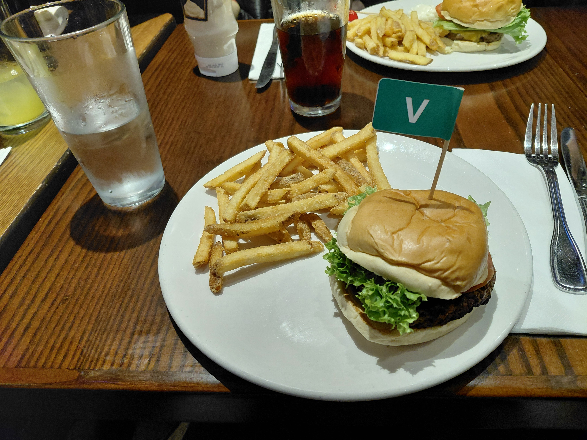
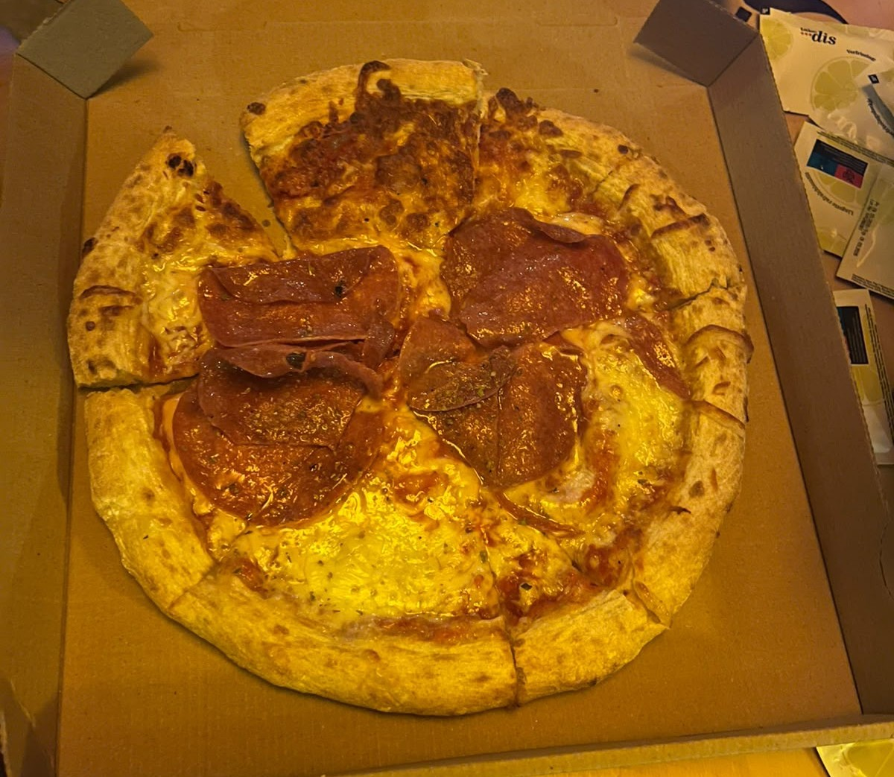

# Top 3 "totes Essen"
## \#3 Reis im Hotel
(Leider keine Bilder vorhanden.) 
Durch die hohe Strahlenbelastung im Gammaspektrum ist es nicht möglich akurate Lichtbilder des Objekts aufzunehmen.
  
## \#2 Die HardRock Cafe Burger

**Standard-Variante**  
Bei einem Geschmackstest gaben nur 9% der Teilnehmenden eine negative Bewertung ab. 91% haben nach dem Essen nicht abgestimmt, ihre Bestattungskosten wurden nicht von den Restaurant-Betreibern getragen.

Stats:
- Konsistenz: Bunter Fahrradreifen
- Zuckerbrot
- Preisleistungstechnische Unterlegenheit gegenüber Mc Donald's

***
**Vegi-Variante**
  

Stats:
- Verbranntes Patty
- Zuckerbrot
- Nachweißlich: Auslöser mehrerer Zombieapokalysen (Quelle: https://www.youtube.com/channel/UC3jv2yNiKPOZoWLLflNOzvg)
  
## \#1 Bastis Pizza

Die Pizzaria entsendet Agenten um jeden der zumindest eine halbe Pizza gegessen hat zu beobachten.  Jedes Versuchsobjekt das fünf Tage nach der Einnahme noch am Leben ist, wird für die Forschung an einem DNS-basierten Supersoldatenserum entführt.

Bei dem Belag handelt es sich um BIO-Zertifizierte Erzeugnisse von lokalen Salami-Bauern.
  
**Zitate**
- "Top drei der totesten Dinge die wir, sobald wir zurück sind, wegwerfen." ~Vater
- "In Deutschland gibt es zwei Arten von Pizzen: Pizzaofen und Steinofen. In Amsterdam gibt es zwei Arten von Pizzen: Tiefkühl und Fritöse." ~Onkel"

  
## Hinweise für Verbraucher
**Vorsicht:** die Einnahme aller oben gelisteten Wirkstoffe ist nach dem Deutschen Beteubungsmittelgesetz untersagt und wird geahndet.  
<i>*Keiner der Hersteller haftet für den Missbrauch dieser Produkte.</i>
