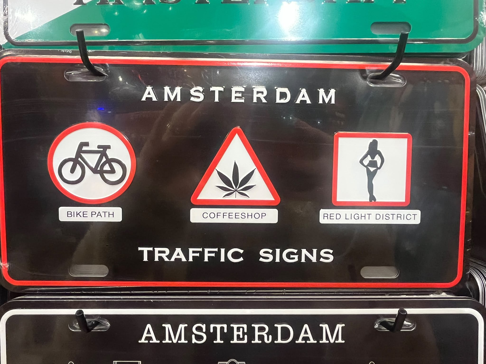
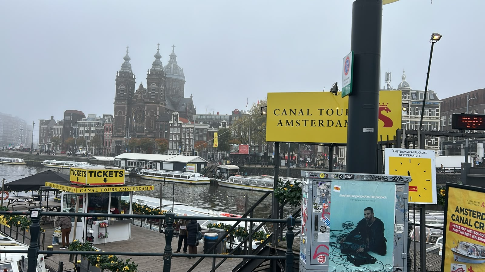
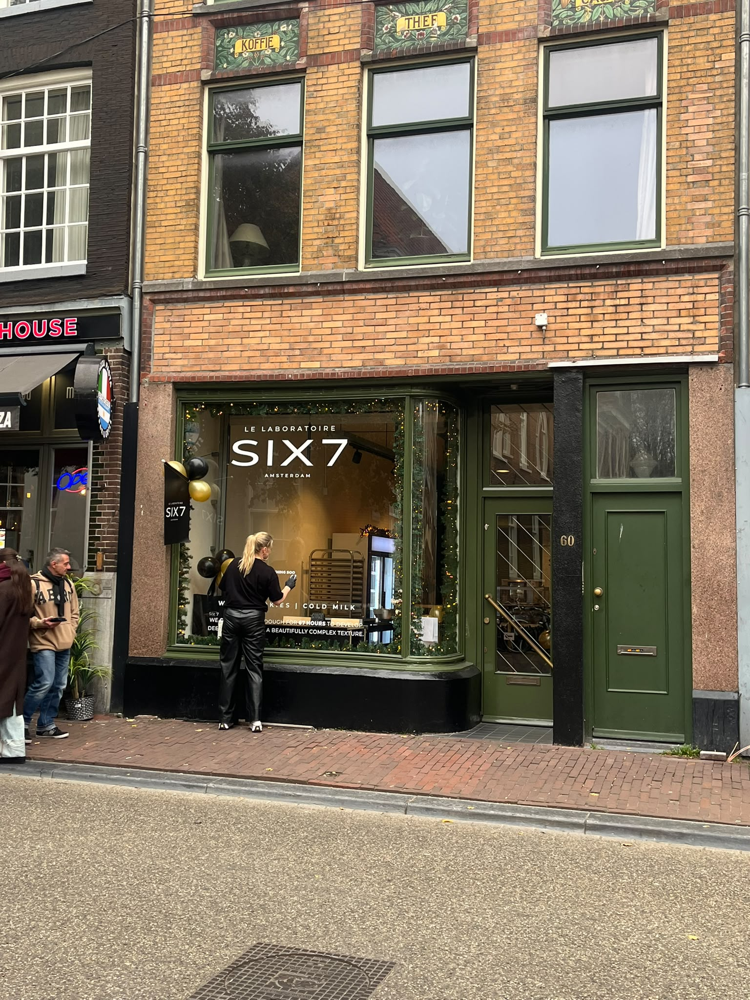

# Top Sehenswürdigkeiten in Amsterdam

Wir haben die Punkte verbunden: 
Amsterdam definiert sich durch fünf Grundpfeiler, welche auch als drei Kreuze im Stadtwappen festgehalten sind:

Namentlich
- Fahrräder
- Cannabis
- Fahrräder
- Fahrräder
- Nutten

Jeder Tourrist **wird unweigerlich** innerhalb der ersten 48 Stunden seines Aufenthalts Speichelkontakt mit allen fünf haben. 
Neben diesen obligatorischen Angeboten gibt es auch noch echte Sehenswürdigkeiten...

## Empfehlung: Der Grachten scam
Schon als Amsterdam vor 670 Jahren Brücken gebaut hat, um über den Fluss zu gelangen, hatten die damaligen Erbauer den Hintergedanken diese Brücken schnellstmöglich wieder einzureisen, um Touristen im großen Stil mit sogenannten Grachten (Aussprche: ɣrɑχt) zu scammen.

Es hat viele Vorteile:
1. An Bord der beheizten Boote ist man durch eine dicke Glasscheibe von den fünf Grundpfeilern der Stadt geschützt.
2. 
3. 
4. 
5. 
6. 
7. 

Wer nach Punkt 6 und 7 noch nicht überzeugt ist, kann auch alternativ das Six7 besuchen.

## Six7

Es handelt sich um ein soziales Experiment, welches seit langem versucht eine Touristengruppe dazu zu bringen, vor der Glasscheibe "six seven" zu schreien und dabei ihre Arme unkontrolliert nach oben und unten zu bewegen. Bislang konnten die Wissenschaftler erst einen Erfolg dokumentieren.

Sobald weitere Beobachtungen dokumentiert ausgewertet sind, kann das Team die Ergebnisse nutzen, um verhaltensgestörte Brainrot-Kinder im Labor zu züchten.

Daher sind alle Touristen aufgefordert sich für die Wissenschaft einzusetzen und an dem Experiment teilzunehmen.
